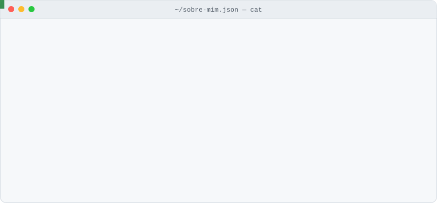
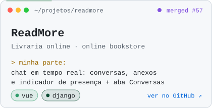
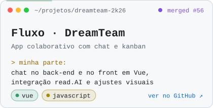
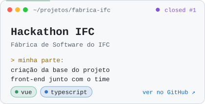
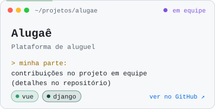
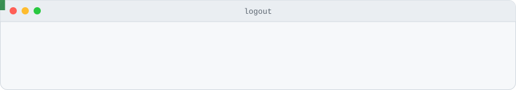

<!--
  Perfil do GitHub de Mateus Lima de Macedo
  Todas as animações são SVGs próprios, guardados na pasta assets/.
  Eles trocam sozinhos entre tema claro e escuro, conforme o tema de quem visita.
-->

<picture>
  <source media="(prefers-color-scheme: dark)" srcset="assets/header-dark.svg">
  
</picture>

 

🇧🇷 Português &nbsp;·&nbsp; <a href="#-english-version">🇺🇸 English version below</a>

## `~/sobre-mim`

Eu sou o **Mateus**, estou finalizando o **Técnico em Informática no IFC – Campus Araquari** e desenvolvo aplicações **full stack**: interfaces com **Vue**, **typescript** e APIs com **Python e Django**.

gosto de trabalhar com times. Tenho alguns projetos do Técnico e particicipei de alguns da Fábrica de Software. Uma dos projetos que mais gostei de construir foi o **Fluxo** (um projeto que fiz com a minha equipe em 24hrs em um hackaton. Ele conta com um chat em tempo real, chamadas de víedeo, transcrição de audio e algumas outras funções).

Link para o projeto Fluxo: https://fluxo-beige-three.vercel.app/

<!--<picture>
  <source media="(prefers-color-scheme: dark)" srcset="assets/about-dark.svg">
  
</picture>-->

## `$ ls ~/stack`

<picture>
  <source media="(prefers-color-scheme: dark)" srcset="assets/stack-dark.svg">
  
</picture>

## `$ ls ~/projetos`

  <a href="https://github.com/ReadMore-Org"><picture><source media="(prefers-color-scheme: dark)" srcset="assets/card-readmore-dark.svg"></picture></a>
  <a href="https://github.com/DreamTeam-2k26"><picture><source media="(prefers-color-scheme: dark)" srcset="assets/card-fluxo-dark.svg"></picture></a>
  <a href="https://github.com/fabricadesoftware-ifc/fabricaHackathon_frontEnd"><picture><source media="(prefers-color-scheme: dark)" srcset="assets/card-hackathon-dark.svg"></picture></a>
  <!-- TROQUE o link abaixo pelo endereço da organização ou do repositório do Alugaê -->
  <a href="https://github.com/mateusLimadeMacedo?tab=repositories"><picture><source media="(prefers-color-scheme: dark)" srcset="assets/card-alugae-dark.svg"></picture></a>

## `$ git log --graph`

<picture>
  <source media="(prefers-color-scheme: dark)" srcset="https://raw.githubusercontent.com/mateusLimadeMacedo/mateusLimadeMacedo/output/snake-dark.svg">
  
</picture>

## `$ ping mateus`

  <!-- TROQUE SEU-LINKEDIN pelo final do link do seu perfil (linkedin.com/in/...) -->
  <a href="https://www.linkedin.com/in/SEU-LINKEDIN"><picture><source media="(prefers-color-scheme: dark)" srcset="assets/btn-linkedin-dark.svg"></picture></a>
  &nbsp;
  <a href="mailto:mateuslimamacedo2008@gmail.com"><picture><source media="(prefers-color-scheme: dark)" srcset="assets/btn-email-dark.svg"></picture></a>

---

### 🇺🇸 English version

I'm **Mateus** a **full stack developer** from **Joinville, Brazil**, finishing my **IT technical degree at IFC – Campus Araquari**.

- 💻 I build web apps with **Vue** and **TypeScript** on the front end and **Python + Django** on the back end.
- 🤝 I work well in teams.
- 💬 Favorite thing I've built: my projet named **fluxo** (https://fluxo-beige-three.vercel.app/). I builded it with my squade in 24 hours on a hackaton.

<picture>
  <source media="(prefers-color-scheme: dark)" srcset="assets/footer-dark.svg">
  
</picture>

